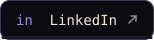
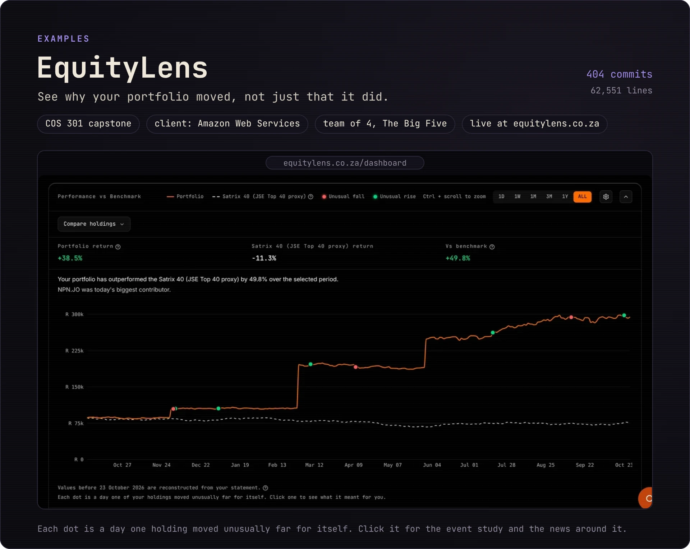
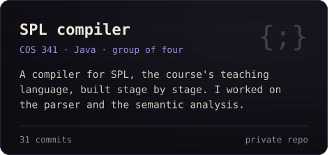
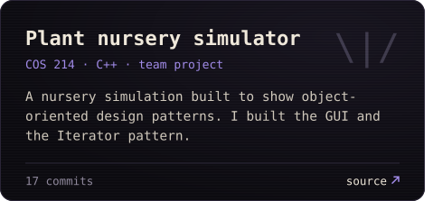
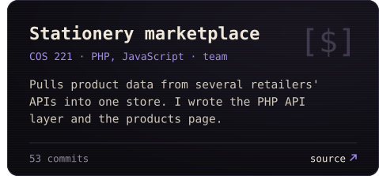
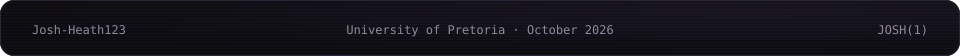

<picture>
  <source media="(prefers-reduced-motion: reduce)" srcset="assets/hero-still.svg">
  
</picture>

  
  
  

<picture>
  <source media="(max-width: 600px)" srcset="assets/about-m.svg">
  
</picture>

<picture>
  <source media="(max-width: 600px)" srcset="assets/stats-m.svg">
  
</picture>

<a href="https://www.equitylens.co.za/"><picture><source media="(max-width: 600px)" srcset="assets/equitylens-m.webp"></picture></a>

<a href="https://github.com/COS301-SE-2026/Equity-Lens"><picture><source media="(max-width: 600px)" srcset="assets/owned-m.svg"></picture></a>

  
  

<picture><source media="(max-width: 600px)" srcset="assets/card-spl-m.svg"></picture><picture><source media="(max-width: 600px)" srcset="assets/card-culprit-m.svg"></picture>

<a href="https://github.com/Josh-Heath123/COS214-Final_Project"><picture><source media="(max-width: 600px)" srcset="assets/card-nursery-m.svg"></picture></a><a href="https://github.com/Josh-Heath123/COS221-Assignment5"><picture><source media="(max-width: 600px)" srcset="assets/card-market-m.svg"></picture></a>

<picture>
  <source media="(max-width: 600px)" srcset="assets/stack-m.svg">
  
</picture>

<picture>
  <source media="(max-width: 600px)" srcset="assets/footer-m.svg">
  
</picture>
