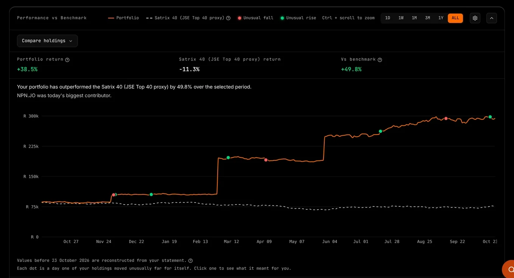
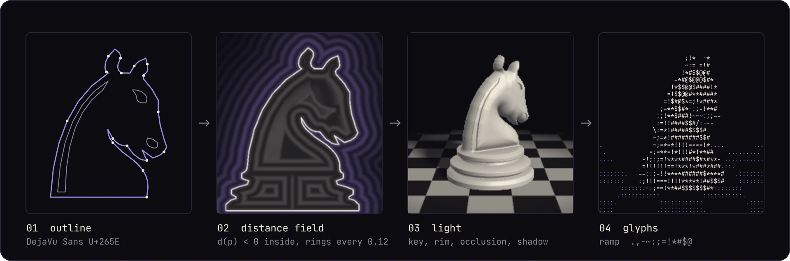

<picture>
  <source media="(prefers-reduced-motion: reduce)" srcset="assets/hero-still.svg">
  
</picture>

### NAME

**josh** — builds a feature end to end, then stays to keep it running

### SYNOPSIS

```
josh [--pipeline] [--api] [--interface]
     --to production problem
```

### DESCRIPTION

I'm Joshua Heath, a final-year BSc Computer Science student at the University of Pretoria, graduating at the end of 2026. I work across the full stack with a focus on data: I build the pipeline, the API and the interface for a feature, then take it to production and look after it once real people are using it.

I'm comfortable anywhere from low-level systems and networking up to production web apps, and I like problems where logic, data and user experience meet. I care about the unglamorous parts as much as the screens: unit tests whose expected values are worked out by hand, migrations that round-trip cleanly, and deployments that keep running when the users arrive.

Away from the keyboard it's gym and gaming. I like a challenge, whether it's physical, recreational or mental.

Open to internships and graduate roles.

### EXAMPLES

**EquityLens** &nbsp;·&nbsp; [equitylens.co.za](https://www.equitylens.co.za/) &nbsp;·&nbsp; [source](https://github.com/COS301-SE-2026/Equity-Lens)

Portfolio analytics for South African retail investors: upload a broker statement, and it rebuilds and prices the portfolio, then explains what a list of holdings can't. Our COS 301 capstone, built by four students (The Big Five) with Amazon Web Services as industry client.



<sub>Performance against the benchmark. Each dot is a day one holding moved unusually far for itself; clicking it opens the event study and the news published around it.</sub>

The parts I own:

- **Dashboard.** The flagship page: time-weighted return and XIRR (Newton's method, with a bisection fallback) against a blended benchmark, a 0–10 health score, and what-if rebalancing.
- **Unusual-move detection.** An EWMA volatility model (λ = 0.94) scores each daily log return against the holding's own recent volatility and flags |z| ≥ 3.
- **Event study.** A market model fitted by OLS splits each flagged move into a market part (β × the market's return) and a company part, with a cumulative abnormal return and a 95% band.
- **News pipeline.** Articles are stored once in Postgres and shared across users, ranked by a hand-written BM25 index plus date proximity and entity matching, and kept current by a nightly job.
- **Guest mode and the landing page.** Visitors can try everything without signing up; a guest's data is deleted when the session ends.

```python
# event_detection.py (excerpt): one recurrence and one ratio.
# EWMA variance with λ = 0.94; a day is unusual when |z| ≥ 3.
variance = LAMBDA * variance + (1 - LAMBDA) * values[i - 1] ** 2
sigma = math.sqrt(variance)
z = r / sigma
```

<sub>React · Vite · FastAPI · Python 3.11 · SQLAlchemy · Alembic · PostgreSQL 16 · Docker · GitHub Actions · Terraform · AWS (EC2, RDS, Cognito, Bedrock)</sub>

**SPL compiler** &nbsp;·&nbsp; COS 341 &nbsp;·&nbsp; group of four

A compiler for SPL, the course's teaching language, built up stage by stage from the lexer and parser to semantic analysis. I worked on the parser and the semantic analysis.

**Plant nursery simulator** &nbsp;·&nbsp; COS 214 &nbsp;·&nbsp; C++ &nbsp;·&nbsp; [source](https://github.com/Josh-Heath123/COS214-Final_Project)

A team-built simulation of a plant nursery (growth, watering, environmental conditions), written to demonstrate object-oriented design, event handling and simulation.

**Stationery marketplace** &nbsp;·&nbsp; COS 221 &nbsp;·&nbsp; PHP, JavaScript &nbsp;·&nbsp; [source](https://github.com/Josh-Heath123/COS221-Assignment5)

A team-built stationery marketplace that pulls product data from several retailers' APIs and presents it in one interface.

**Culprit** &nbsp;·&nbsp; personal &nbsp;·&nbsp; early days

A diagnostic engine: a multimeter for software. Rather than another dashboard, it probes the relationships between components to work out what is wrong, where and why, with the evidence attached. Deterministic first; AI is an optional extra, never the source of truth.

### ENVIRONMENT

```text
LANGUAGES   Java  Python  TypeScript  C++  SQL  Prolog
FRONTEND    React  Next.js  Angular  Vite  Tailwind CSS
BACKEND     FastAPI  Node.js  Express  NestJS  SQLAlchemy  Alembic
DATA        PostgreSQL  Supabase  pandas  NumPy
CLOUD       AWS  Azure  Docker  GitHub Actions
```

### FILES

The knight at the top is 72 frames of plain text inside one SVG, drawn by a small raymarcher that lives in this repository.



- [`tools/knight.py`](tools/knight.py) (under 300 lines, numpy only) sphere-traces a signed distance field: a lathed pedestal, plus the outline of the DejaVu Sans black-knight glyph (U+265E), extruded and rounded. Each character cell averages nine rays; every hit gets a key light, a rim light, ambient occlusion and a soft shadow on the board, and the brightness picks a character from the ramp in donut.c: `.,-~:;=!*#$@`.
- [`tools/build_hero.py`](tools/build_hero.py) packs the frames into [`assets/hero.svg`](assets/hero.svg). A single CSS `@keyframes` rule plays them, since GitHub won't run JavaScript in a README. Rows that never change are stored once, the font is a subset of JetBrains Mono embedded as WOFF2, and visitors who prefer reduced motion get [`hero-still.svg`](assets/hero-still.svg) through a `<picture>` source.

To rebuild it: `pip install numpy fonttools brotli`, then `python tools/build_hero.py`.

### BUGS

Asks to see the working behind any number on a screen, including his own.

### SEE ALSO

[LinkedIn](https://www.linkedin.com/in/joshua-heath-a910b5367/) &nbsp;·&nbsp; [joshuaheath004@gmail.com](mailto:joshuaheath004@gmail.com) &nbsp;·&nbsp; [EquityLens](https://www.equitylens.co.za/)

<br>

<p align="center"><sub><code>Josh-Heath123 &nbsp; · &nbsp; University of Pretoria &nbsp; · &nbsp; October 2026 &nbsp; · &nbsp; JOSH(1)</code></sub></p>
